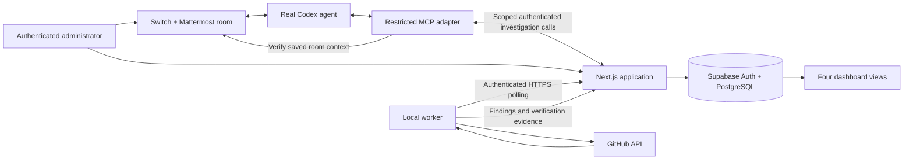

# Offboard

**When someone leaves, prove their access is gone.**

Offboard coordinates an access investigation, an authenticated human decision, and an independent provider rescan. The application has four primary views: **Overview**, **People & Offboarding**, **Integrations**, and **Verification Reports**. All operational counts, findings, connection states, jobs, and reports come from Supabase records.

Built for **Best Business Workflow** in Flip the Switch. A real Codex agent investigates in a Switch-connected Mattermost room; the human reviews the exact correction through Offboard, and a restricted local worker performs the approved provider operation and independently verifies it. [Build article draft](docs/blog/offboard-with-switch.md).

## Current verification

- Supabase Auth is connected; schema migrations and RLS are applied to the development project.
- A real automatic proposal email reached the administrator, who explicitly confirmed the controlled identity and approved its removal through the private review. The approval was consumed once. GitHub accepted the removal, and a later independent check verified the exact membership absent. These are separately persisted events; email delivery or an accepted deletion response alone cannot establish removal.
- A real authenticated read-only journey has passed: case → persisted job → worker → GitHub enumeration → saved partial-coverage report. The protected integration account’s membership was discovered. Six authenticated routes returned HTTP 200. A later browser-driven scan also passed through the actual dashboard action and polling worker; its saved report appeared automatically.
- Unauthorized worker requests returned HTTP 401. Database tests exercise non-admin refusal, protected identities, mismatched targets, expiry, single use, duplicate proposals, failed verification, partial coverage, and crash recovery inside a rolled-back transaction. Exhausted read-only retries produce terminal failure reports instead of leaving cases indefinitely investigating.
- **A live controlled GitHub membership removal is verified.** The user-authorized `oluwafemi-akolade` account (stable ID `167610953`) was removed from `Optimus-pro-orgs`. The immediate rescan still reported access; that report is preserved. One separate read-only follow-up confirmed absence and saved a new report. The owner/integration account was protected throughout. Coverage remains partial; this does not clear other systems or permissions.
- A genuine Switch/Codex/Mattermost investigation passed: an owner room request → restricted MCP tools → persisted scan job → real GitHub worker scan → saved partial-coverage report → the agent’s evidence-based reply in the same thread. The complete live removal and final post-removal room confirmation remain pending. A later request for the controlled account was posted at the user’s direction, but the local agent hit its account usage limit before investigating; do not count that attempt as a successful agent scan.
- Vercel provider checks are not implemented. The application itself has not been deployed. The homepage, sign-in, all four dashboard views, case details, and a real report received a rendered browser review. Phone (320px) and tablet (768px) checks found no horizontal overflow in the four primary views; homepage checks also covered 390px and desktop 1280px. Basic keyboard focus was checked; this is not a complete accessibility certification.

This is an in-progress workflow, not a claim of completed company offboarding.

## People, cases, and providers

A case represents one person leaving. **Integrations** connects the company's authorized organizations or teams; each case associates the person's separately confirmed accounts with those providers. Findings, approvals, and verification retain their provider and exact permission scope.

Today the simple case form asks for the person's name, departure date, and GitHub username. Approval email goes to the confirmed administrator; Gmail is not a provider identity lookup. As working connectors are added, the same case can contain GitHub, Vercel, and other confirmed identities, with accounts managed inside the case. A work email may help identify the departure record but cannot establish account ownership or authorize a removal. Multi-provider case handling is planned; GitHub is the only implemented connector. Administrator invitations and role management follow completion of the core journey; V1 uses one configured administrator.

The intended future shortcut is **Check all connected providers**, with an optional multiselect to narrow a case's scope. Company integration setup can guide an administrator through several selected providers, but each provider retains its own authorization and genuine connection status. Creating a departure records the intended scope; it does not silently authorize a new integration or approve any removal. The shared investigation still begins through Switch.

## Local setup

Use Node.js 24 LTS and npm:

```sh
nvm use
npm ci
cp .env.example .env
```

Fill in `.env` locally. Existing configured files should be kept; do not overwrite them with the example. Real environment files, `privates-notes/`, `.local/`, and build output are ignored by Git.

| Variable                               | Where it runs / purpose                                                                                                                                              |
| -------------------------------------- | -------------------------------------------------------------------------------------------------------------------------------------------------------------------- |
| `NEXT_PUBLIC_SUPABASE_URL`             | App: Supabase project URL.                                                                                                                                           |
| `NEXT_PUBLIC_SUPABASE_PUBLISHABLE_KEY` | App: public API key; RLS still governs database access.                                                                                                              |
| `SUPABASE_SECRET_KEY`                  | App server and setup scripts only: privileged key, never a browser or agent credential.                                                                              |
| `SUPABASE_DB_URL`                      | Migration/tests only: PostgreSQL connection URL. Use the session pooler when the direct hostname is unreachable. Percent-encode reserved characters in the password. |
| `OFFBOARD_ADMIN_EMAIL`                 | Server: confirmed Auth email permitted to bootstrap as administrator.                                                                                                |
| `OFFBOARD_APP_URL`                     | Worker: `http://127.0.0.1:3000` locally; HTTPS application origin when hosted.                                                                                       |
| `OFFBOARD_WORKER_TOKEN`                | App server + worker: shared random bearer secret of at least 32 characters. Generate with `openssl rand -hex 32`. Never give it to the agent.                        |
| `GITHUB_ACCESS_TOKEN`                  | Local worker only: authorized GitHub user token, or omit when using `--github-cli-auth`.                                                                             |
| `GITHUB_ORGANIZATION`                  | Worker: the single authorized organization allowlist.                                                                                                                |
| `GITHUB_TEST_USERNAME`                 | Explicit read-only CLI/live-test target. Does not confirm a removal identity.                                                                                        |
| `GITHUB_PROTECTED_USER_IDS`            | Worker: comma-separated stable IDs protected in addition to owners and the integration identity.                                                                     |
| `RESEND_API_KEY`                       | App server only: Resend send-email API key. Never expose it to the worker, agent, or browser.                                                                        |
| `APPROVAL_EMAIL_FROM`                  | App server: `Offboard <notifications@paayee.org>`; the domain must be verified in Resend.                                                                            |
| `GITHUB_REMOVAL_TEST_USER_IDS`         | Worker: stable IDs of explicitly authorized disposable test accounts. Empty means every removal is refused.                                                          |

Find the Supabase URL and API keys in [project settings](https://supabase.com/docs/guides/getting-started/api-keys). Obtain the database URL from **Connect**; see [connection methods](https://supabase.com/docs/guides/database/connecting-to-postgres). Neither database passwords nor Auth passwords belong in chat or the repository.

```sh
npm run env:check
npm run db:migrate
npm run dev
```

The migration runner applies checksummed SQL files in one transaction with an advisory lock. Never edit an applied migration; add a subsequent migration. If a database connection is unavailable, the migration files can be reviewed and applied in order in Supabase SQL Editor; keep migration history consistent before switching back to the runner.

In **Supabase → Authentication → Users**, create a confirmed user whose email matches `OFFBOARD_ADMIN_EMAIL`. Use that user’s password at [the local sign-in page](http://127.0.0.1:3000/sign-in). On successful validated sign-in, only that allowlisted email can bootstrap an administrator profile. User metadata cannot grant roles. There is no public signup or browser-side role editing.

Neue Montreal Regular, Medium, and Bold are loaded locally through `next/font/local`. All page and component appearance uses Tailwind. The global stylesheet contains only Tailwind imports and theme declarations.

## Provider worker

Run the web app and worker in separate terminals:

```sh
# Reuse an existing authorized GitHub CLI sign-in; token stays in memory.
npm run worker:run -- --github-cli-auth
```

Omit the flag when using `GITHUB_ACCESS_TOKEN`. The CLI reads the existing credential with a fixed `gh auth token --hostname github.com` command. Agent input is never converted into shell commands.

In **Integrations**, add the configured GitHub organization. The record stays unverified until the worker completes a real check. In **People & Offboarding**, create a case and request a scan. A successful scan resolves the stable user ID; an administrator must separately confirm that identity before approving a removal.

Standalone, read-only diagnostics remain available:

```sh
npm run worker:doctor -- --github-cli-auth
npm run worker:scan -- --github-cli-auth
```

The worker supports GitHub user tokens with active administrator membership. GitHub App authentication is not implemented. Read checks require permissions for organization member and outside-collaborator enumeration; removal requires the corresponding write/admin permission and any required SSO authorization. A successful connection check does not prove write capability. Consult the [organization members](https://docs.github.com/en/rest/orgs/members) and [outside collaborators](https://docs.github.com/en/rest/orgs/outside-collaborators) APIs.

Requests use a fixed GitHub API origin, reject redirects, validate responses, and constrain pagination to the requested scope. Errors are sanitized; raw tokens, headers, and response bodies are not stored.

## Authorization, jobs, and evidence



Authenticated users read under administrator RLS. Mutations use narrow server-authorized database functions. Worker functions are executable only with the server’s service role, behind bearer-authenticated application endpoints. The local worker receives scoped jobs rather than a Supabase secret key. Agent transport and human approval are separate trust boundaries.

Approvals bind an immutable snapshot of the stable account ID, organization ID, username, exact grant, and action. They expire after 15 minutes. Execution requires a currently authorized approver, confirmed matching identity, fresh provider preflight, no protection flags, a valid job lease, and successful transactional single-use consumption. The worker additionally requires the target’s ID in `GITHUB_REMOVAL_TEST_USER_IDS`. Owners, the integration identity, privileged accounts, and configured protected IDs are refused.

### Automatic private email review

A completed real scan automatically queues eligible, unprotected findings for its requesting administrator’s confirmed email. Delivery runs on the application server after authenticated worker polling; the agent and worker receive neither Resend credentials nor private review tokens. There is no manual send step in the normal flow. **Email me this proposal** remains available to request a fresh link. Manual requests can only address the signed-in administrator’s own confirmed Supabase email; callers cannot supply an arbitrary recipient. Configure `RESEND_API_KEY` and `APPROVAL_EMAIL_FROM`. No Gmail OAuth or inbox access is needed: Resend sends the message to the administrator’s mailbox.

The HTML email uses React Email and Tailwind with a plain-text fallback. Both show the person, GitHub username, organization, proposed change, expiry, and a clear review action. Technical resource identifiers and execution details stay in the authenticated evidence report. The private review uses concise decision-focused copy. Email clients use a safe font fallback when Neue Montreal is unavailable.

The URL has a random 256-bit capability in its fragment, which is removed from the address bar on page load. Only its SHA-256 hash is stored. It is not a dashboard session and grants no other permissions. The review API accepts same-origin JSON POST only; opening the page/email does not approve anything. The recipient must explicitly review and approve or reject. If the provider identity is still unconfirmed, approval also requires a separate identity checkbox; the server records that exact identity association atomically with the decision. Opening or previewing the link never confirms identity. Tokens are kept only in browser memory, never local storage; review pages prohibit framing, referrer transmission, and indexing.

Each link lasts 15 minutes and allows one decision. Its finding must also remain fresh. When an eligible pending review becomes stale, the app can queue one genuine read-only refresh; approval stays unavailable until the result is fresh and the target still matches. **Refresh check** reloads the saved review state. The server rechecks the recipient’s confirmed email/current administrator role, immutable target, account protection, provider identity match, explicit identity acknowledgement when needed, and finding freshness. A changed target, expired/used link, ambiguous email submission, or newer dashboard decision fails closed. Requests are limited to one per minute per administrator. The durable queue deduplicates recent proposals. A crashed sender becomes uncertain and is never automatically retried; provider rejection or changed/ineligible targets remain explicit failures or skips. Mail submission cannot change a scan or removal result. Link possession authenticates this narrow decision: forwarding it grants the holder that capability, so keep it private. Agents receive neither the link secret nor any approval tool.

Both email and dashboard decisions use the same transactional approval rules. Reports record the administrator and authorization channel. The worker still checks and consumes the approval once, performs a fresh provider preflight, and independently rescans. Resend acceptance, the human decision, provider execution, and verified removal are separate persisted states. **Resend acceptance is not proof of inbox delivery.** Timeouts or unsaved acceptance leave the link unusable; the app never automatically resends an uncertain submission. After fixing the cause, request a fresh link.

For deployment set `OFFBOARD_APP_URL` to the public HTTPS origin before sending email. The local test link works only on a device that can reach the development app. Disable email click tracking for approval messages to preserve private review URLs. See the official [Resend send-email API](https://resend.com/docs/api-reference/emails/send-email) and [domain verification guide](https://resend.com/docs/dashboard/domains/introduction).

Claims use row locks and `SKIP LOCKED`; one approval can create only one execution job and one operation. A worker issues DELETE only after a positive approval-consumption acknowledgement. It never automatically retries DELETE. A lost response or expired destructive lease stays uncertain. Read-only jobs have bounded lease retries. Repeated completion submissions cannot create duplicate evidence.

After a provider operation, a separate scan checks the exact permission. If an accepted removal's immediate check still reports access, one persisted read-only follow-up is queued; it never repeats DELETE. The new report preserves the original approval and operation evidence alongside the fresh check, and the original report remains unchanged. Reports distinguish **verified removed**, **access remains**, **verification failed**, **partially verified**, and **not checked**. Missing or incomplete coverage cannot establish absence. Even a verified GitHub removal leaves the case partially verified: enterprise permissions, pending invitations, other organizations, Vercel, and other services remain outside this connector’s coverage. GitHub’s username-addressed mutation API cannot make preflight and deletion one atomic provider transaction; keep test grants explicitly controlled.

For an uncertain job, inspect its report and perform a new read-only investigation before proposing another correction. There is no automatic destructive recovery or global “all access cleared” status. Reports and audit records are not editable through the application; a database administrator remains privileged.

Pending-job views refresh saved records automatically while queued or leased work exists. Case-form validation identifies the invalid field and preserves the entered values. Native controls use Tailwind’s dark color-scheme utility.

Worker availability is based on a recent saved heartbeat. It says nothing about whether the separate Codex agent is online. The interface does not claim continuous agent availability.

## Switch and Mattermost

Install the official [Switch Console](https://docs.switchagents.ai/switch-rooms/getting-started/install-switch-console), with Docker running. Select **On this computer**, then [configure the Codex provider](https://docs.switchagents.ai/switch-rooms/getting-started/set-up-agent-providers), [onboard an agent](https://docs.switchagents.ai/switch-rooms/getting-started/onboard-agents), and [create a room](https://docs.switchagents.ai/switch-rooms/getting-started/create-a-room).

The tested local setup used Console 0.40.1, Switch server 0.31.0, Codex CLI 0.167.0, and Mattermost. Agent `offboard` has a dedicated ignored directory `.local/switch-agent`. Auto mode is on with the user’s explicit approval; Bypass permissions and agent management remain off. Its audience is owner-only. The project configuration disables shell tools, app connectors, and unrelated inherited MCP servers. It has no GitHub credential, Supabase secret, worker token, or approval tool.

Room `security-offboarding` is a genuine Mattermost-backed room. The local setup selected `http://localhost:52426/switch/channels/security-offboarding`; ports may change after recreating the server. A real role/connectivity response and a later complete read-only investigation were received. The later agent used `inspect_case`, `request_scan`, and `get_job`; its findings matched the saved GitHub report.

Room/agent instructions must require: investigate only through restricted application tools; discuss saved findings; never fabricate evidence; never approve an action; use authenticated dashboard or private email review for human decisions; preserve unchecked and failed coverage; never disclose credentials. The adapter re-reads room details and conversation history from the authenticated Switch API before each application call. It requires a real message from the configured human sender, an explicit case UUID, the configured Mattermost room/agent, and an allowlisted case. A notification relay alone is insufficient.

### Restricted investigation tools

Copy `.env.switch.example` to `.env.switch` and set its permissions to `600`. This file is read only by the local MCP subprocess; do not load the web app’s `.env` into the agent. It contains the app URL, a separate `OFFBOARD_SWITCH_TOKEN`, the existing agent credential-file path, one room ID, one agent ID, the authorized human’s exact Switch transport sender ID, and explicit case UUIDs. The web server’s `.env` must contain the same token/scope values plus `OFFBOARD_SWITCH_INTEGRATION_ID`. Its existing `OFFBOARD_ADMIN_EMAIL` must identify a current administrator profile. Keep the worker token different.

Find IDs through the authenticated Switch `list_rooms`, `get_room_detail`, and `read_context` operations, using the installed version’s [agent protocol](https://docs.switchagents.ai/switch-rooms/internals/agent-protocol). Match the actual sender ID in saved context; names supplied by an LLM are insufficient. Console-managed agent credentials in the tested release live under `~/Library/Application Support/switchdash/agent-controller/servers/<server ID>/agents/<agent ID>/credentials.json`. Some Console agent types use `.switch/agents/<name>.json` in their working directory. Point to the existing agent-specific file; do not paste its contents into chat. No new Switch registration or broad provider credential is required.

Create `.local/switch-agent/.codex/config.toml`, replacing paths with your installation’s absolute paths:

```toml
web_search = "disabled"
[features]
shell_tool = false
apps = false
multi_agent = false
[tools]
view_image = false
[mcp_servers.offboard]
command = "/absolute/path/to/node-24"
args = ["--import", "tsx", "/absolute/path/to/offboard/agent/src/server.ts"]
cwd = "/absolute/path/to/offboard/.local/switch-agent"
enabled_tools = ["inspect_case", "request_scan", "get_job"]
[mcp_servers.switch]
enabled_tools = ["read_context", "list_rooms", "get_room_detail", "list_participants", "post_message", "send_targeted_message", "connect_to_room"]
```

Disable every unrelated inherited MCP server in this project config with its own `[mcp_servers.<name>]` and `enabled = false`. Review the effective tool catalog before using real cases. Mark only the dedicated directory trusted in the Codex user configuration. In Switch Console 0.40.1, Auto mode off forces that directory untrusted and suppresses project MCP configuration; use Auto mode with explicit operator approval, keep Bypass off, then restart the agent. [Agent settings](https://docs.switchagents.ai/switch-rooms/getting-started/agent-settings) and [Codex MCP configuration](https://learn.chatgpt.com/docs/extend/mcp) describe these controls. The application’s removal authorization remains independent of that provider permission mode.

The local subprocess has exactly three application tools. It exposes no shell, identity-confirmation, approval, provider mutation, or arbitrary HTTP tool. `request_scan` requires a room request no older than 15 minutes; saved-result reads accept that source for 24 hours. Every call rechecks Switch context and the app validates a fresh adapter attestation, configured scope, and current administrator mapping. A unique database key makes one room/message reuse its original scan job. Pending work and unavailable services remain pending or failed.

The bridge bearer credential is a trusted local service credential, not a signed message from Switch. Its holder can attest room context, so protect `.env.switch`, the adapter code, and the host. The model sees tool results, not that credential. Running processes under the same OS user is not strong host isolation; a future multi-user deployment needs a separately controlled service identity/runtime. Only explicitly allowlisted synthetic/test cases are enabled in the tested setup.

Run the app and provider worker, keep Switch/agent running, then send `@offboard investigate <case UUID>` in the configured Mattermost room. The agent reads saved context, inspects the case, requests one scan, reads its job/report, and discusses the actual evidence and dashboard links. Case pages identify Switch-origin jobs; reports retain the verified source-message context. A subsequent explicit human dashboard or private-email approval is still required for any correction.

If Codex sign-in expires, renew the existing login with `codex login`. Console may retain a stale session authentication copy; the tested release copies sign-in into `~/.local/state/switch/sdk-sessions/<session hash>/provider-home/<session hash>/`. Stop the affected agent before refreshing that cache, preserve old files privately, and restart. Never paste authentication contents into logs or chat.

## Validation

```sh
npm run check
npm run build

# Opt-in: real database functions and roles, all fixture records rolled back.
npm run db:test

# Opt-in: real Auth, app endpoints, GitHub scan, and persisted evidence; no DELETE.
# Requires the local app running and a confirmed configured administrator.
npm run test:live:read-only -- --github-cli-auth
```

Offline tests use synthetic provider fixtures strictly inside tests. The live read-only check generates and consumes an in-memory administrator Auth link without sending email or changing a password, bootstraps only the configured confirmed administrator, records a clearly named protected-account test case, queues genuine provider checks, and inspects the saved report. It does not test browser rendering or substitute for a live removal demonstration. Stop other worker processes while running this diagnostic. It refuses active mutation jobs, supplies no removal adapter, and requires a report for the exact scan job created by that run.

Latest validation: 70 offline tests and 107 real PostgreSQL safety checks passed, with database fixtures rolled back. Formatting, lint, types, and the production build passed. Live unauthorized worker and bridge approval requests were refused. These checks complement the recorded controlled removal; they do not establish an untested provider or hosted deployment.

Production uses the supported Webpack build option because this environment restricted Turbopack’s internal PostCSS port. TypeScript is pinned to 6.0 while the lint parser adds TypeScript 7 support. Narrow minimatch overrides patch [GHSA-g3hv-75wg-m249](https://github.com/advisories/GHSA-g3hv-75wg-m249); remove them when upstream dependencies resolve to patched versions. Some nested Next.js lint plugins emit ESLint 10 peer-range warnings.

## Controlled demonstration

1. Create a separate test GitHub account you control, or use an existing disposable non-owner account. Complete its verification, invite it as an ordinary organization member, and accept the invitation. Do not use the owner/integration account. Record its stable ID in the worker’s removal allowlist only after authorizing that test grant.
2. Start the app, worker, Switch, Mattermost, and Codex. Confirm worker connectivity and the agent’s actual availability separately.
3. Create the departure case. Begin the investigation by asking the agent in `security-offboarding` to scan that case. Use `@offboard investigate <case UUID>`; the case must be included in the adapter’s allowlist.
4. Inspect the real saved findings discussed in the room. The eligible proposal is automatically emailed to the confirmed administrator. Confirm the exact provider identity in the dashboard or the private review.
5. Demonstrate an unauthorized request being refused. Then explicitly approve the exact controlled grant through the authenticated dashboard or private email review.
6. Observe the worker’s provider operation and independent scan; inspect the saved target, approver, provider response, timestamps, and remaining coverage.
7. Have the agent report that same saved outcome in the room. Keep an unavailable provider marked unresolved.

The chat-initiated read-only investigation and the human-email-approved removal are verified separately. The controlled removal used dashboard-origin scans because the local Switch agent hit its account usage limit. A complete room-initiated removal journey and genuine post-removal room confirmation remain acceptance work. Do not splice those separate runs into a claim that the complete journey passed.

### Recorded controlled removal — 7 November 2026

| Evidence             | Saved record / UTC time                                                                                                                   |
| -------------------- | ----------------------------------------------------------------------------------------------------------------------------------------- |
| Controlled case      | `8633dd87-a673-4cfb-8def-b7cb5179fab7`                                                                                                    |
| Human email approval | `eba3b438-d87f-4eea-b598-35da679d7a9f` · 13:34:37                                                                                         |
| GitHub operation     | `956e03f2-ec2c-435a-9326-bf85e9dc67ae` · HTTP 204 at 13:34:40                                                                             |
| Immediate report     | `ebae41d1-0970-462b-91a9-fb16406b0f8d` · access remains                                                                                   |
| Read-only follow-up  | `6a20ee60-cb04-4f88-a1f1-c44e706d2f22`                                                                                                    |
| Final report         | [Verified membership removal](http://127.0.0.1:3000/reports/5d0c1c26-78fc-47ca-9e55-0aefa2423e62) · 13:40:37 · partially verified overall |

A redesigned verification receipt was sent for this saved result; Resend subsequently reported `delivered`. The user then located it in Gmail Spam and supplied its rendered screenshot, alongside GitHub's own organization-removal notification. These emails support the saved independent rescan; neither replaces it. Automatic proposal delivery is implemented; automatic result receipts are not implemented.

The sender-domain check found `paayee.org` verified in Resend, its SPF/DKIM records verified, a published DMARC monitoring policy, and open/click tracking disabled. This checks sender configuration, not the authentication headers of the received message or Gmail's reason for its placement. Use the deployed public HTTPS origin in email links before the next delivery test. Follow the [Resend Gmail deliverability guide](https://resend.com/guides/email/deliverability/avoid-gmail-spam-folder); no configuration guarantees inbox placement.

For the next full-journey recording, a fresh ordinary-member invitation was sent and accepted by the user. GitHub confirmed the controlled account is an active ordinary member again. This new test grant awaits its own investigation and explicit human approval; the earlier removal report describes the earlier grant. Record actual saved reports, real provider state, and genuine room messages. Keep passwords, environment files, and complete private approval URLs out of the recording. The earlier immediate “access remains” result is useful evidence of independent checking; it must not be hidden or rewritten.

### Demo readiness and evidence

The official [schedule](https://www.wemakedevs.org/hackathons/switch/schedule) lists submissions closing **7 November 2026, 11:59 PM IST — 7:29 PM Africa/Lagos**. The [challenge page](https://www.wemakedevs.org/hackathons/switch) requires a real human/agent workflow with Switch central to it. The user-provided submission-form screenshots specify:

| Material           | Requirement                                                                                                                              |
| ------------------ | ---------------------------------------------------------------------------------------------------------------------------------------- |
| Project details    | Title, selected track, and description of the problem and intended users.                                                                |
| Repository         | Public project repository with a README explaining setup, connected agents, channel configuration, and how to run the workflow.          |
| Video              | **Under 3 minutes**, hosted on **YouTube or Loom**, public or unlisted. Show the agent working in a real chat with teammates.            |
| Switch explanation | Which agent, which chat platform, what real work it performs, and how people collaborate with it.                                        |
| Switch feedback    | What worked, what got in the way, and what should improve.                                                                               |
| Deployment         | Optional in the submission form; still an agreed project goal.                                                                           |
| Extras             | Optional blog and #HowISwitch post. A Wispr usage card is conditional on Code with Wispr; PR links are conditional on Core Contribution. |

Prepare materials now, but capture the complete combined workflow before representing it as verified. The article is a local draft, not a published blog link. No video, hosted deployment, or public repository URL exists yet.

- Finish one genuine room-initiated controlled investigation through human approval, real removal, independent verification, and the agent's saved-result reply.
- Deploy the application to Vercel and verify Auth, email review, separate worker/bridge authentication, and local polling against its HTTPS origin. Switch, Mattermost and the agent can remain local. This project goal must not delay the mandatory public repository and running-workflow video if the submission deadline becomes tight.
- Complete the final keyboard, mobile and error-state review; record actual unauthorized-action refusal and show unavailable providers remaining unchecked.
- Publish a reviewed repository and README, prepare shareable evidence images, record the video, and verify judges can open the links. Registration and final entry are performed by the participant, in accordance with the [official rules](https://www.wemakedevs.org/hackathons/switch/rules).

Twenty-two original screenshots are retained locally under `.local/demo-evidence/originals/`, indexed by `.local/demo-evidence/evidence-manifest.json` with source descriptions and SHA-256 hashes. The archive is ignored by Git. It includes historical errors, design/setup references, genuine application/room captures, the human approval screenshot, both removal emails, and six submission-form references. Older images expose private approval links or inbox information. Keep originals unchanged; publish only separately reviewed copies. The archive is not part of a public clone, and historical/reference images must not be presented as a new successful run.

## Deployment and structure

Deploy the Next.js app to Vercel with the Supabase, worker-auth, scoped Switch-adapter, and optional Resend environment values. Keep GitHub credentials on the worker. Point the local worker and `.env.switch` at the HTTPS deployment, using their separate matching credentials. Vercel must not attempt to contact a laptop’s localhost: the local adapter verifies Switch context and calls the hosted app. Configure production Auth URLs and verify authorization, polling, and the genuine room investigation on the deployed origin before recording a demonstration. No deployment has been performed yet.

For the hackathon, Switch, Mattermost, Codex, and the worker can remain local. Future hosting needs a deployment compatible with Switch/Mattermost’s services, persistent storage, and agent lifecycle. An existing Cloudflare subscription alone does not establish that this stack can run there; no cloud runtime has been provisioned or validated.

- `src/app/`: routes and shared route states; four protected views plus nested case/report screens.
- `src/components/`: shared navigation and accessible UI pieces.
- `src/core/`: validated domain contracts and independent safety policy.
- `src/features/auth/`: authentication actions.
- `src/features/approvals/`: private email review contract and Tailwind interface.
- `src/server/`: session authorization, database queries/actions, worker API boundary.
- `worker/src/`: provider adapters, job executor, authenticated polling, CLI.
- `agent/src/`: restricted MCP tools, validated configuration, authenticated Switch context checks.
- `supabase/migrations/`: schema, RLS, transactional approval/job functions, and subsequent fixes.
- `scripts/`: environment checks, migrations, transactional database tests.
- `tests/integration/`: explicitly invoked live read-only workflow check.
- `privates-notes/`: three optional local planning documents, excluded from Git; this README is the public setup reference.
