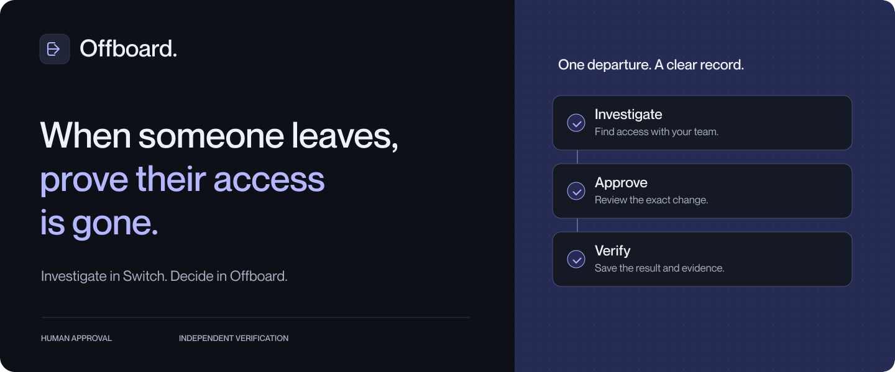
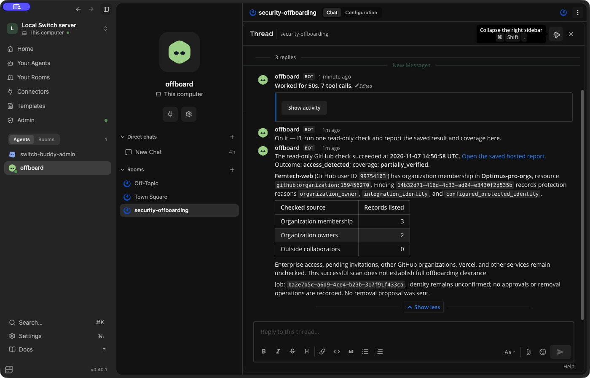
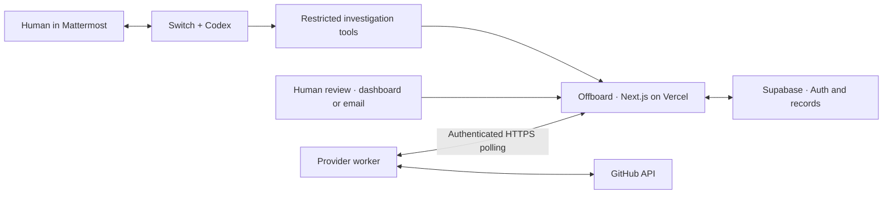

# Offboard

[](https://offboard-mu.vercel.app)

**Human-approved access removal, independently verified.**

Offboard helps founders, engineering leads, and IT teams find and remove access left behind when someone leaves. A Codex agent investigates with your team in Switch. A human approves the exact change. A fresh provider check verifies the result.

[Live app](https://offboard-mu.vercel.app) · [How we use Switch](#how-we-use-switch) · [Run locally](#run-locally) · [Build story](docs/blog/offboard-with-switch.md)

## Why Offboard

The idea came from firsthand experience: after leaving a team, I still had access to its GitHub, Apple, and Vercel accounts, including visibility into new code updates. My work had ended; my access had not.

That leaves internal code and company information exposed beyond the end of a role. Offboard helps the team discover remaining access, approve and carry out its removal, and check that the change took effect. The investigation, decision, and result stay in one record.

The first connector supports GitHub organization membership and outside-collaborator access. Every finding, approval, removal, and report comes from actual provider checks and saved records.

## For judges

Built for **Best Business Workflow** in the [Flip the Switch hackathon](https://www.wemakedevs.org/hackathons/switch).

- **See the product:** [sign in to Offboard](https://offboard-mu.vercel.app/sign-in) with **`test@user.com`** and password **`Password`**. This read-only demo account shows the controlled case and its saved reports.
- **Follow the workflow:** a human request in the Switch-connected Mattermost room leads to a real GitHub investigation, a private approval email, human approval, removal, an independent check, and the agent’s reply in the same thread.
- **Inspect the result:** open the [saved removal report](https://offboard-mu.vercel.app/reports/5ed69f67-52e5-44a5-a7f5-b362e995b169) after signing in. The build story explains the actual run; the setup guide lets reviewers reproduce it with their own accounts.

The complete controlled GitHub journey passed on 7 November 2026. GitHub accepted the removal, the immediate check still found access, and a separate read-only follow-up confirmed the membership absent. Both reports are retained. A later investigation also passed through the hosted app and returned its HTTPS report link in Switch.



## How it works

1. **Create a departure.** Add the person, departure date, and GitHub account.
2. **Investigate together.** Ask `@offboard investigate <case UUID>` in the team room. The agent requests a provider check and discusses the saved findings.
3. **Review the change.** Offboard emails an eligible proposal to the administrator. Confirm the account and approve or reject that exact removal, through the private email review or dashboard.
4. **Verify the result.** Offboard rechecks the target, performs the approved operation, independently scans again, and saves the evidence. The agent reads those records and reports back in the room.

The dashboard stays focused on **Overview**, **People & Offboarding**, **Integrations**, and **Verification Reports**.

## How we use Switch

We connected a **Codex agent named `offboard`** through **Switch Console** to the **Mattermost** room `security-offboarding`.

The human starts an investigation in the room, where the agent can read the shared conversation and use three restricted Offboard tools:

| Tool           | What it does                                                        |
| -------------- | ------------------------------------------------------------------- |
| `inspect_case` | Reads the person, account, findings, decisions, and saved evidence. |
| `request_scan` | Requests one read-only GitHub investigation for the named case.     |
| `get_job`      | Reads progress and the report for that investigation.               |

The local adapter checks the actual room and human request before calling Offboard. The team discusses findings in the same thread. An administrator makes the removal decision separately, and the agent returns to the saved approval, provider response, and verification when explaining the outcome.

Switch provides the shared context and agent participation for this workflow. It is more than a notification destination. The agent has no approval or removal tool and never receives the provider credential or private review link.

### Set up the channel and agent

1. Install [Switch Console](https://docs.switchagents.ai/switch-rooms/getting-started/install-switch-console), start its local server with Docker running, and configure the Codex provider.
2. Create the `offboard` agent with a dedicated working directory, then add it to a Mattermost room named `security-offboarding`.
3. Configure the three-tool MCP adapter and the matching room, human sender, case, and integration scope in Offboard. Keep Bypass off and review the effective tools.
4. Start the app and provider worker, keep the agent online, and send the investigation request in the room.

The [setup guide](docs/setup.md#switch-and-mattermost) includes the exact environment files, Codex configuration, room instructions, and troubleshooting. The tested versions were Switch Console 0.40.1, Switch server 0.31.0, and Codex CLI 0.167.0.

## Run locally

Requires **Node.js 24**, npm, Supabase, an authorized GitHub organization, and Switch Console with Docker and a signed-in Codex provider. Resend is used for email reviews.

```sh
nvm use
npm ci
cp .env.example .env
```

Fill in your own values using the [configuration guide](docs/setup.md#local-setup), create the confirmed Supabase administrator, and run:

```sh
npm run env:check
npm run db:migrate
npm run dev
```

In another terminal:

```sh
npm run worker:run -- --github-cli-auth
```

In the app, connect the authorized GitHub organization and create a case. Configure the Switch adapter before requesting a room investigation. Use a separate account you control for any removal test; the organization owner and integration account remain protected.

[Full setup and deployment guide →](docs/setup.md)

## Architecture



The application and persistent records are hosted. Switch, Mattermost, Codex, and the provider worker run locally for the current demonstration. New work requires those sessions to be online. Provider credentials stay with the worker; the hosted app and investigation adapter use separate credentials.

## Human control and verification

- **Exact approval:** each decision binds one account, organization, permission, and proposed operation. Approvals expire and can be used once.
- **Protected accounts:** owners, the integration identity, and configured protected accounts cannot be removed.
- **Private email review:** eligible proposals are sent automatically. Opening a link changes nothing; a separate explicit decision is required. The link lasts 15 minutes and must not be forwarded.
- **Independent evidence:** an accepted provider response is saved separately from the follow-up check. Reports preserve the approver, target, operation, response, verification, and remaining coverage.
- **Clear outcomes:** verified removed, access remains, partially verified, verification failed, and not checked stay distinct. A verified GitHub permission does not clear other systems.

## Supported today

| Capability                                                       | Status                                                                |
| ---------------------------------------------------------------- | --------------------------------------------------------------------- |
| GitHub organization membership and outside-collaborator checks   | Implemented with real provider APIs.                                  |
| Controlled organization-member removal                           | Tested end to end with human approval and an independent rescan.      |
| Switch-led investigation and room follow-up                      | Tested with Codex and Mattermost; also tested against the hosted app. |
| Automatic proposal emails                                        | Implemented and received in the controlled workflow.                  |
| Verification receipt email                                       | Template tested; automatic result delivery is planned.                |
| Vercel access checks, other providers, administrator invitations | Planned.                                                              |

V1 has one configured administrator, case-scoped read-only reviewers, and a deliberately restricted GitHub test scope. Email may reach Spam. The current GitHub check does not cover enterprise permissions, pending invitations, other organizations, or other services. See the [setup guide](docs/setup.md#authorization-jobs-and-evidence) for operational details.

## Development

```sh
npm run check       # formatting, lint, types, and offline tests
npm run build       # production build
npm run db:test     # opt-in PostgreSQL checks; fixtures roll back
```

The latest completed validation passed **80 offline tests** and **132 PostgreSQL safety checks**. Hosted checks also confirmed protected routes, separate service permissions, and refusal of unauthorized removal and approval requests. Live provider tests are separate and require explicitly authorized resources.

```text
src/app/              Routes and four dashboard views
src/features/         Cases, approvals, and reports
src/server/           Auth, queries, and application operations
src/core/             Domain contracts and safety policy
worker/               Provider checks, execution, and verification
agent/                Restricted Switch investigation tools
supabase/migrations/  Schema, RLS, and transactional workflow
scripts/              Environment, migration, and database checks
docs/                 Setup guide, build story, and reviewed images
```
