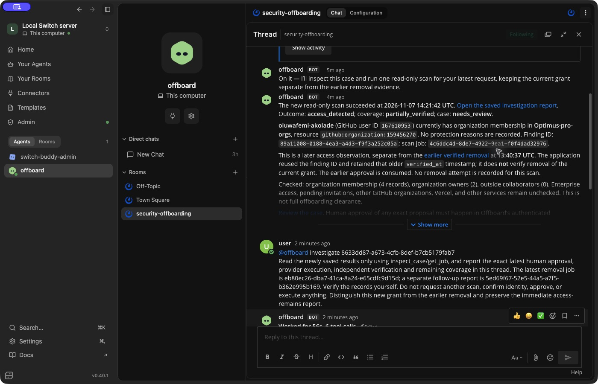
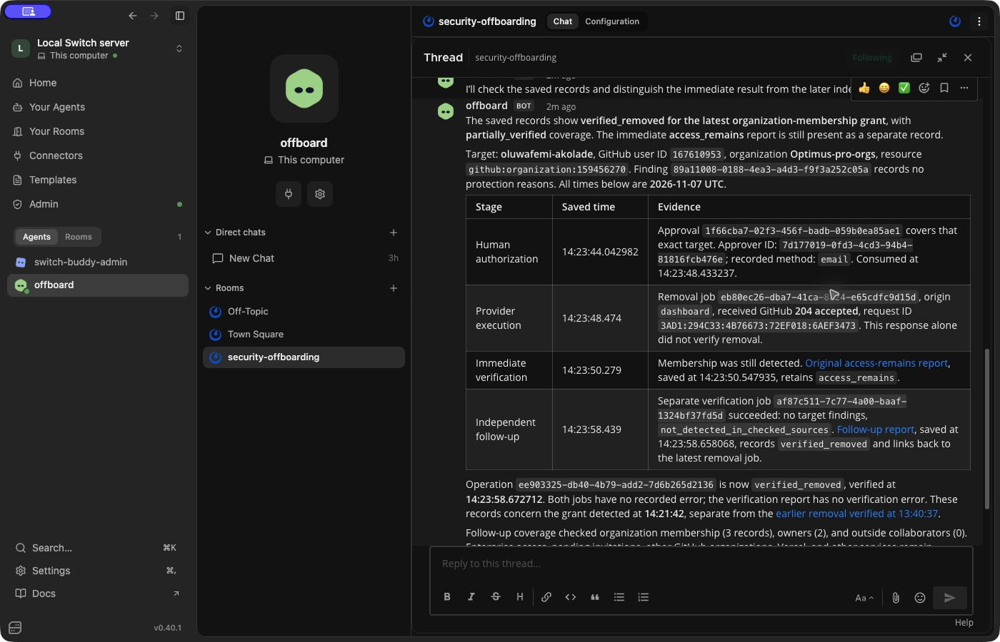

# The GitHub run, step by step

On **7 November 2026**, Offboard investigated a controlled GitHub account through Switch, sent a removal proposal to the human, carried out their approved change, and independently confirmed the membership was gone. The agent then explained the saved result in the same team-chat thread.

This page documents that completed run with its actual records and unaltered Switch screenshots. You can read it without signing in. The same records are available in the dashboard through the optional links below.

## The test

| Item                | Controlled test scope                                                                 |
| ------------------- | ------------------------------------------------------------------------------------- |
| Person              | Controlled removal test — Oluwafemi                                                   |
| GitHub account      | `oluwafemi-akolade` · user ID `167610953`                                             |
| Organization        | `Optimus-pro-orgs` · organization ID `159456270`                                      |
| Access to remove    | Organization membership, ordinary member                                              |
| Protected account   | `Femtech-web`, the owner and integration account                                      |
| Shared conversation | Codex agent `offboard` in the Switch-connected Mattermost room `security-offboarding` |

The user controls both accounts and authorized the test. The target accepted a fresh ordinary-member invitation before this run. An earlier removal had already completed; its approval could not authorize this new grant.

## 1. Start the investigation in the team room

The investigation began with a real human request in `security-offboarding`:

```text
@offboard investigate 8633dd87-a673-4cfb-8def-b7cb5179fab7
```

The Codex agent inspected the case, requested a read-only GitHub scan, and read its progress through the restricted Offboard tools. The chat request did not authorize a removal. The agent had no approval or removal tool.

## 2. Discover the actual access

The scan completed at **14:21:42 UTC**. GitHub reported the controlled account's organization membership as present. The check enumerated **4 members, 2 owners, and 0 outside collaborators**. The target was an ordinary member, with no recorded protection reason.

Offboard saved an **access detected** investigation report. The agent shared the findings in the room and distinguished this new grant from the earlier completed removal.



The reply also identified an older verification date retained on the rediscovered finding. That state-transition bug was subsequently fixed: new positive scans clear the old date, while historical reports remain intact.

## 3. Send the proposal and receive the human decision

The successful investigation automatically sent a private proposal email to the authorized administrator. It identified the person, GitHub account, organization, and proposed membership removal.

The human reviewed the proposal and explicitly approved it at **14:23:44 UTC**. The saved authorization records **private email review** as its channel. Opening the message or its link was not approval, and the agent made no decision on the human's behalf.

That approval applied to this exact membership removal and could be used once. Private review links are intentionally excluded from this public walkthrough.

## 4. Carry out the approved removal

Offboard validated the authorization and target before making the GitHub request. The approval was consumed at **14:23:48 UTC**; GitHub accepted the operation with **HTTP 204** at **14:23:48.474 UTC**.

The provider response was saved separately from verification. An accepted request did not yet establish that the membership was absent.

## 5. Preserve the first result: access remains

The immediate independent check at **14:23:50.279 UTC** still detected the membership. Offboard saved **access remains** in its original report.

That report was retained. It was not overwritten by the later result.

## 6. Check again independently: removal verified

A separate read-only follow-up at **14:23:58.439 UTC** found no access for the target in the checked sources. It enumerated **3 members, 2 owners, and 0 outside collaborators** and saved a new **verified removed** report at **14:23:58.658 UTC**.

The follow-up did not repeat the deletion. A subsequent direct GitHub check also confirmed the target absent while the protected owner remained active.

| Event                                        | Recorded time, UTC |
| -------------------------------------------- | ------------------ |
| Investigation completed; membership present  | 14:21:42           |
| Human approved through private email review  | 14:23:44           |
| GitHub accepted the removal                  | 14:23:48           |
| Immediate independent check: access remains  | 14:23:50           |
| Separate independent check: verified removed | 14:23:58           |

The two checks establish what was observed at those times. They do not establish why the results differed.

## 7. Bring the evidence back to the conversation

The human asked the agent to review the saved outcome in the original thread. At **14:25 UTC**, Codex read the actual approval, operation, and reports and explained the result back to the room. It preserved the first access-remains result and identified what remained unchecked.



The final outcome was **GitHub organization membership removed and independently verified**. Overall case coverage remained **partially verified**: enterprise access, pending invitations, other GitHub organizations, Vercel, and other services were not checked.

## Inspect the saved records in Offboard

The walkthrough above requires no app login. To inspect the underlying records, [sign in to the dashboard](https://offboard-mu.vercel.app/sign-in) with the read-only demo account **`test@user.com`**, password **`Password`**, then open:

- [The investigation: access detected](https://offboard-mu.vercel.app/reports/6dc2af74-6d23-4b96-8140-085b4e7eec9e).
- [The immediate verification: access remains](https://offboard-mu.vercel.app/reports/04442243-5752-49b8-94cd-1dc211a8764b).
- [The independent follow-up: verified removed](https://offboard-mu.vercel.app/reports/5ed69f67-52e5-44a5-a7f5-b362e995b169).

The controlled removal ran before the app was deployed. The hosted dashboard now exposes those same saved records. A later hosted read-only investigation was a separate check; it is not part of this removal sequence.

<details>
<summary>Record references for this run</summary>

| Record                        | Reference                              |
| ----------------------------- | -------------------------------------- |
| Case                          | `8633dd87-a673-4cfb-8def-b7cb5179fab7` |
| Switch investigation source   | `sw_4d8b92702995f73d1843c76f6df97c97`  |
| Human approval                | `1f66cba7-02f3-456f-badb-059b0ea85ae1` |
| Provider operation            | `ee903325-db40-4b79-add2-7d6b265d2136` |
| GitHub request                | `3AD1:294C33:4B76673:72EF018:6AEF3473` |
| Investigation report          | `6dc2af74-6d23-4b96-8140-085b4e7eec9e` |
| Immediate verification report | `04442243-5752-49b8-94cd-1dc211a8764b` |
| Follow-up verification report | `5ed69f67-52e5-44a5-a7f5-b362e995b169` |

</details>

[Back to the README](../README.md) · [Build story](blog/offboard-with-switch.md) · [Reproduce the workflow](setup.md)
